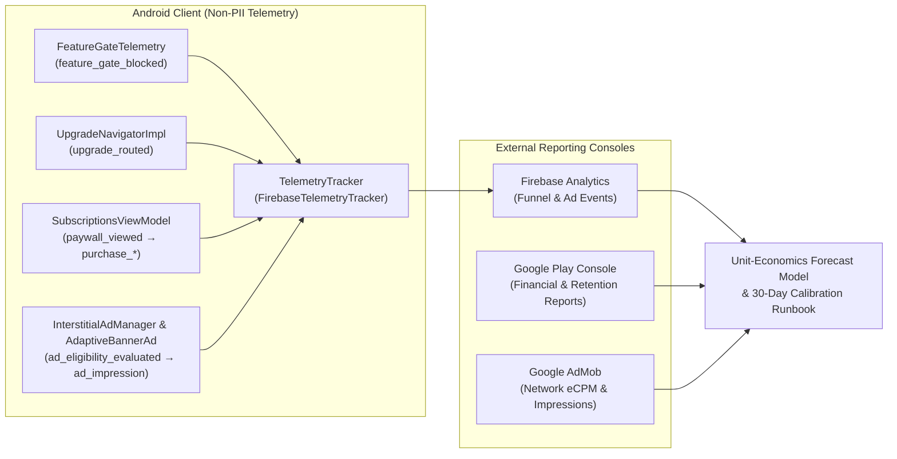

# Monetization Funnel & Unit-Economics Forecast Model

> **Canonical Reference:** This guide bridges SplitTrip's live non-PII `MonetizationTelemetry` events with Google Play Console subscription reports and Google AdMob network reports. It defines the authoritative conversion-funnel ratios, post-15%-fee unit-economics and LTV equations, break-even thresholds, scenario forecast tables, and 30-day post-launch calibration runbook used to govern Phase 2 (`#2019`, `#2020`, `#2021`) and Phase 4 (`#2025`) monetization experiments.

---

## 🏛️ 1. Overview & Dual-Engine Monetization Architecture

SplitTrip operates a dual-engine monetization model: a **Pro Subscription** engine for power users and a **Free-Tier Advertising** engine for ad-supported users.

### 1.1 Subscription Engine (`SubscriptionTier.PRO`)
- **Billing & Entitlement Layer:** Powered by Google Play Billing (`BillingService` / `PlayBillingClientWrapper`) and governed by `FeatureGateService` and `SubscriptionsViewModel`.
- **SKUs ([`BillingConstants`](../../domain/src/main/kotlin/es/pedrazamiguez/splittrip/domain/constant/BillingConstants.kt)):**
  - `split_trip_pro_monthly` (`BillingInterval.MONTHLY`): **€2.99/month** gross list price.
  - `split_trip_pro_annual` (`BillingInterval.ANNUAL`): **€26.99/year** gross list price (~€2.25/month gross equivalent, ~25% savings vs `12 × €2.99 = €35.88`, formatted in `SubscriptionsUiMapperImpl`).
- **Gated Capabilities (`GatedFeature`) & Tier Quotas (`GatedLimit` / Remote Config):**
  - `GatedFeature.GROUP_COVER_UPLOAD`, `GatedFeature.SUBUNIT_CREATION`, `GatedFeature.AI_RECEIPT_SCANNING`, `GatedFeature.AD_FREE`.
  - `GatedLimit.MAX_OWNED_GROUPS_COUNT`: `max_owned_groups_free = 1` vs `max_owned_groups_pro = -1 (unlimited)`.
  - `GatedLimit.MAX_MEMBERS_PER_GROUP`: `max_members_per_group_free = 4` vs `max_members_per_group_pro = 20`.
  - AI Receipt OCR monthly quota: `ai_receipt_monthly_limit_free = 0` (pre-Phase 2 baseline; `3` in `#2019`) vs `ai_receipt_monthly_limit_pro = 100`.
- **Complimentary Allowlist Exclusion:** Users matching `pro_allowlist_email_hashes` receive `SubscriptionTier.PRO` entitlements without a Google Play transaction (`isAllowlistedPro = true` in `SubscriptionsViewModel`) and **must be excluded** from paid ARPPU and conversion numerators.

### 1.2 Advertising Engine (`SubscriptionTier.FREE`)
- **Ad Governance:** Controlled by `ShouldShowAdsUseCase` and `AppConfigRepository` via the `ads_enabled` Remote Config flag (conditioned to `false` under `"Pre-1.0.0 Closed Test"` where `app.build.<(['1000000'])`, and `true` for `v1.0.0+`).
- **Anchored Adaptive Banner (`AdaptiveBannerAd` in `MainScreen`):** Unit ID `admob_banner_ad_unit_id`.
- **Full-Screen Interstitial (`InterstitialAdManager`):** Unit ID `admob_interstitial_ad_unit_id`, evaluated on transactional action completions (`onActionCompleted`) subject to:
  - `ad_interstitial_action_frequency` (default `2`)
  - `ad_interstitial_min_interval_seconds` (default `90`)

### 1.3 Architecture & Telemetry Flow



---

## 📊 2. Funnel & `MonetizationTelemetry` Mapping

Every constant in [`MonetizationTelemetry`](../../core/logging/src/main/kotlin/es/pedrazamiguez/splittrip/core/logging/MonetizationTelemetry.kt) maps to an explicit conversion stage or ad-yield metric.

### 2.1 Subscription & Feature-Gate Conversion Funnel (`Stage F1` → `Stage F6`)

| Stage | Event (`MonetizationTelemetry.Event`) | Emitter Class(es) | Parameters (`MonetizationTelemetry.Param`) & Allowed Values | Stage Conversion / Rate Formula |
| :--- | :--- | :--- | :--- | :--- |
| **F1: Gate Friction** | `feature_gate_blocked` | `GroupsScreenUiProviderImpl`, `CreateEditGroupViewModel`, `CreateEditGroupImageEventHandlerImpl`, `CreateEditGroupSubmitEventHandlerImpl`, `ReceiptAutoFillEventHandler`, `SubunitManagementScreenUiProviderImpl`, `SubunitManagementViewModel`, `CreateEditSubunitViewModel` (via [`FeatureGateTelemetry`](../../core/design-system/src/main/kotlin/es/pedrazamiguez/splittrip/core/designsystem/telemetry/FeatureGateTelemetry.kt)) | `gate_type`: `"feature"` \| `"limit"`<br>`gate_name`: `"group_cover_upload"`, `"subunit_creation"`, `"ai_receipt_scanning"`, `"max_owned_groups_count"`, `"max_members_per_group"`<br>`entry_point`: 15 `GateEntryPoint` constants<br>`upgrade_prompted`: `true` \| `false` | **Gate Hit Rate per Free MAU:**<br>`R_gate = count(feature_gate_blocked) / MAU_free`<br>**Prompted Share:**<br>`R_prompted = count(upgrade_prompted == true) / count(feature_gate_blocked)` |
| **F2: Upgrade Routing** | `upgrade_routed` | `UpgradeNavigatorImpl.navigateToUpgrade` | `entry_source`: `"settings"`, `"groups_fab"`, `"group_creation"`, `"group_member_limit"`, `"group_cover_upload"`, `"subunit_management"`, `"subunit_creation"`, `"ai_receipt_scanning"`, `"direct"`<br>`destination`: `"subscriptions"` \| `"account_status"`<br>`is_anonymous`: `true` \| `false` | **Gate-to-Route Rate:**<br>`CR_gate_route = count(upgrade_routed where entry_source != "settings") / count(feature_gate_blocked where upgrade_prompted == true)`<br>**Anonymous Intercept Share:**<br>`R_anon_gate = count(upgrade_routed where is_anonymous == true) / count(upgrade_routed)` |
| **F3: Paywall Impression** | `paywall_viewed` | `SubscriptionsViewModel.trackPaywallViewedIfNeeded` (once per VM instance for non-anonymous users) | `entry_source`: `EntrySource`<br>`current_tier`: `"free"` \| `"pro"`<br>`billing_interval`: `"monthly"` \| `"annual"` | **Route-to-Paywall Rate:**<br>`CR_route_paywall = count(paywall_viewed where current_tier == "free") / count(upgrade_routed)` |
| **F4: Plan Exploration** | `billing_interval_selected` | `SubscriptionsViewModel.handleSelectBillingInterval` | `billing_interval`: `"monthly"` \| `"annual"`<br>`current_tier`: `"free"` \| `"pro"` | **Annual Exploration Rate:**<br>`R_annual_toggle = distinct_users(billing_interval_selected where billing_interval == "annual") / distinct_users(paywall_viewed where current_tier == "free")` |
| **F5: Checkout Initiation** | `purchase_initiated` | `SubscriptionsViewModel.handleUpgradeToPro` | `target_tier`: `"pro"`<br>`billing_interval`: `"monthly"` \| `"annual"`<br>`entry_source`: `EntrySource` | **Paywall-to-Checkout Rate:**<br>`CR_paywall_checkout = count(purchase_initiated) / count(paywall_viewed where current_tier == "free")` |
| **F6: Checkout Resolution** | `purchase_completed`<br>`purchase_pending`<br>`purchase_canceled`<br>`purchase_failed` | `SubscriptionsViewModel` (`observePurchaseUpdates`, `handlePurchaseSuccess`, `launchBillingFlow`, `handleUpgradeToPro`) | `target_tier`: `"pro"`<br>`billing_interval`: `"monthly"` \| `"annual"`<br>`is_already_owned`: `true` \| `false` (`purchase_completed` only)<br>`entry_source`: `EntrySource` (`purchase_completed` only)<br>`failure_stage`: `"product_unavailable"`, `"launch_billing_flow"`, `"purchase_update"`, `"tier_persistence"` (`purchase_failed` only) | **Checkout Completion Rate:**<br>`CR_checkout_complete = count(purchase_completed where is_already_owned == false) / count(purchase_initiated)`<br>**End-to-End Paywall Conversion:**<br>`CR_paywall_total = count(purchase_completed where is_already_owned == false) / count(paywall_viewed where current_tier == "free")`<br>**Checkout Cancel Rate:**<br>`R_cancel = count(purchase_canceled) / count(purchase_initiated)`<br>**Billing Technical Failure Rate:**<br>`R_fail = count(purchase_failed) / count(purchase_initiated)` |

### 2.2 Gate Entry-Point to Paywall Entry-Source Attribution Matrix

The 15 `MonetizationTelemetry.GateEntryPoint` constants map onto the 9 `MonetizationTelemetry.EntrySource` values and their underlying `GatedFeature` / `GatedLimit`:

| `GateEntryPoint` Constant(s) | Wire Value(s) | Mapped `EntrySource` | Underlying Gate |
| :--- | :--- | :--- | :--- |
| `GROUPS_FAB` | `groups_fab` | `EntrySource.GROUPS_FAB` (`"groups_fab"`) | `GatedLimit.MAX_OWNED_GROUPS_COUNT` |
| `GROUP_CREATE_INIT`, `GROUP_SUBMIT` | `group_create_init`, `group_submit` | `EntrySource.GROUP_CREATION` (`"group_creation"`) | `GatedLimit.MAX_OWNED_GROUPS_COUNT` |
| `GROUP_MEMBER_SELECT`, `GROUP_MEMBER_SCAN`, `GROUP_MEMBER_UPSELL`, `GROUP_MEMBER_SUBMIT` | `group_member_select`, `group_member_scan`, `group_member_upsell`, `group_member_submit` | `EntrySource.GROUP_MEMBER_LIMIT` (`"group_member_limit"`) | `GatedLimit.MAX_MEMBERS_PER_GROUP` |
| `GROUP_COVER_LOCKED_PREVIEW`, `GROUP_COVER_PICK` | `group_cover_locked_preview`, `group_cover_pick` | `EntrySource.GROUP_COVER_UPLOAD` (`"group_cover_upload"`) | `GatedFeature.GROUP_COVER_UPLOAD` |
| `SUBUNIT_FAB`, `SUBUNIT_CREATE_EVENT` | `subunit_fab`, `subunit_create_event` | `EntrySource.SUBUNIT_MANAGEMENT` (`"subunit_management"`) | `GatedFeature.SUBUNIT_CREATION` |
| `SUBUNIT_CREATE_INIT`, `SUBUNIT_SUBMIT` | `subunit_create_init`, `subunit_submit` | `EntrySource.SUBUNIT_CREATION` (`"subunit_creation"`) | `GatedFeature.SUBUNIT_CREATION` |
| `AI_MODE_TOGGLE`, `AI_RECEIPT_ATTACH` | `ai_mode_toggle`, `ai_receipt_attach` | `EntrySource.AI_RECEIPT_SCANNING` (`"ai_receipt_scanning"`) | `GatedFeature.AI_RECEIPT_SCANNING` |
| *(Settings menu direct entry)* | — | `EntrySource.SETTINGS` (`"settings"`) | Direct navigation |
| *(Deep link / unattributed fallback)* | — | `EntrySource.DIRECT` (`"direct"`) | Fallback |

**Source-Specific Paywall Conversion Rate:**

```text
CR_source(s) = count(purchase_completed where entry_source == s and is_already_owned == false)
             / count(paywall_viewed where entry_source == s and current_tier == "free")
```

### 2.3 Entitlement Recovery & Churn-Intent Events

- **`restore_purchases_attempted`**, **`restore_purchases_succeeded`**, **`restore_purchases_empty`**, **`restore_purchases_failed`:**
  - **Restore Success Rate:** `R_restore = count(restore_purchases_succeeded) / count(restore_purchases_attempted)`
- **`manage_subscription_opened`** (`current_tier`):
  - **Voluntary Churn Intent Rate:** `R_churn_intent = distinct_users(manage_subscription_opened where current_tier == "pro") / MAU_pro_paid` (leading indicator of Google Play subscription cancellation).

### 2.4 Advertising Funnel & Yield Mapping (`InterstitialAdManager` & `AdaptiveBannerAd`)

Maps all 6 ad lifecycle events (`ad_eligibility_evaluated`, `ad_loaded`, `ad_load_failed`, `ad_impression`, `ad_dismissed`, `ad_show_failed`):

- **Eligibility Decomposition (`ad_eligibility_evaluated` by `reason` in `MonetizationTelemetry.AdEligibilityReason`):**
  - Total completed transactional actions evaluated: `N_eval = count(ad_eligibility_evaluated where ad_type == "interstitial")`
  - Free-tier ad-enabled actions: `N_eval_free = count(ad_eligibility_evaluated where reason != "ads_disabled")`
  - Suppression shares among Free-tier actions:
    - Frequency cap suppression: `S_freq = count(reason == "frequency_cap") / N_eval_free`
    - Cooldown interval suppression: `S_cooldown = count(reason == "min_interval_cooldown") / N_eval_free`
    - Cache/inventory starvation: `S_no_cache = count(reason == "no_cached_ad") / N_eval_free`
    - Eligible share: `R_elig = count(reason == "eligible") / N_eval_free` (where `S_freq + S_cooldown + S_no_cache + R_elig = 1`)
- **Inventory Starvation Rate (Missed Eligible Impressions):**
  `R_starved = count(reason == "no_cached_ad") / (count(reason == "eligible") + count(reason == "no_cached_ad"))`
- **Client Ad Fill Rate (`ad_type` in `{"banner", "interstitial"}`):**
  `R_fill(t) = count(ad_loaded where ad_type == t) / (count(ad_loaded where ad_type == t) + count(ad_load_failed where ad_type == t))`
- **Interstitial Show Render Rate & Show Failure Rate:**
  `R_render_int = count(ad_impression where ad_type == "interstitial") / count(ad_eligibility_evaluated where is_eligible == true)`
  `R_show_fail = count(ad_show_failed where ad_type == "interstitial") / count(ad_eligibility_evaluated where is_eligible == true)`
- **Impressions per Free MAU:**
  `I_ban_MAU = count(ad_impression where ad_type == "banner") / MAU_free`
  `I_int_MAU = count(ad_impression where ad_type == "interstitial") / MAU_free`

---

## 🧮 3. Canonical Unit-Economics Equations

> **Precision Convention:** All currency amounts in scenario tables are rounded to 2 decimal places (`EUR`), while sub-cent per-MAU ad ARPU intermediates retain 4 decimal places to preserve summation accuracy.

### 3.1 Net Subscription Revenue (Post-15% Google Play Service Fee)

Under Google Play's 15% service fee tier (`fee_play = 0.15`, net retention factor `1 - fee_play = 0.85`):

- **Monthly Plan (`split_trip_pro_monthly`):**
  - Gross list price: `P_gross_mo = €2.99`
  - Post-15%-fee net price: `R_net_mo = €2.99 × 0.85 = €2.5415 ≈ €2.54/month`
- **Annual Plan (`split_trip_pro_annual`):**
  - Gross list price: `P_gross_yr = €26.99/year` (`€2.2492/month` gross, `24.78%` savings vs `€35.88/year`)
  - Post-15%-fee net annual price: `R_net_yr = €26.99 × 0.85 = €22.9415 ≈ €22.94/year`
  - Amortized monthly net revenue: `R_net_yr_mo = €22.9415 / 12 = €1.9118 ≈ €1.91/month`

> **VAT / Sales Tax Reconciliation Note:** For EU transactions where Google Play remits VAT from the list price prior to applying the 15% fee, financial report reconciliation uses `R_net_ex_vat = (P_gross / (1 + r_vat)) × 0.85`. Product forecast tables standardize on the post-15% Play fee baseline (`€2.54/mo` and `€22.94/yr` / `~€1.91/mo`).

### 3.2 Plan Mix & Blended Subscription ARPPU / ARPU

Given active paid Pro share `c_pro = MAU_pro_paid / MAU`, annual plan mix `w_annual = count(active_annual) / MAU_pro_paid`, and monthly plan mix `w_monthly = 1 - w_annual`:

- **Blended Monthly Net Subscription ARPPU (accrual / MRR basis):**
  `ARPPU_sub_mo = (w_monthly × €2.54) + (w_annual × €1.91)`
- **First-Month Cash Realization per New Paid Conversion (cash basis):**
  `Cash_new_conv = (w_monthly × €2.54) + (w_annual × €22.94)`
- **Subscription Net ARPU across Total MAU:**
  `ARPU_sub = c_pro × ARPPU_sub_mo`

### 3.3 Free-Tier AdMob Net ARPU

Disaggregated by ad format (`banner` vs `interstitial`):

```text
ARPU_ad_free = ((I_ban_MAU / 1000) × eCPM_net_ban) + ((I_int_MAU / 1000) × eCPM_net_int)
```

*(Reduces to `(impressions_per_MAU / 1000) × net_eCPM` when using a format-weighted blended eCPM.)*

- **Ad Net ARPU across Total MAU:**
  `ARPU_ad_total = (1 - c_pro) × ARPU_ad_free`
- **Total Blended Monthly Net ARPU & Net MRR:**
  `ARPU_total = ARPU_sub + ARPU_ad_total = (c_pro × ARPPU_sub_mo) + ((1 - c_pro) × ARPU_ad_free)`
  `MRR_net = MAU × ARPU_total`

### 3.4 Cohort Retention, Churn & Lifetime Value (LTV)

- **Monthly Subscriber Net LTV (`LTV_sub_mo`):**
  Given monthly billing churn rate `churn_mo` (`0 < churn_mo <= 1`):
  - `Expected Tenure (months) = 1 / churn_mo`
  - `LTV_sub_mo = €2.54 / churn_mo`
- **Annual Subscriber Net LTV (`LTV_sub_yr`):**
  Given annual non-renewal rate `churn_yr` (`0 < churn_yr <= 1`):
  - `Expected Tenure (years) = 1 / churn_yr`
  - `LTV_sub_yr = €22.94 / churn_yr`
- **Blended Paid Pro Cohort LTV (`LTV_pro`):**
  `LTV_pro = (w_monthly × LTV_sub_mo) + (w_annual × LTV_sub_yr)`
- **Free-Tier Ad Cohort LTV (`LTV_ad_free`):**
  Given monthly Free user attrition `churn_free`:
  `LTV_ad_free = ARPU_ad_free / churn_free`

### 3.5 Break-Even Threshold Equations

1. **Pro vs. Free Monthly Value Multiplier (`M_pro_free`):**
   `M_pro_free = ARPPU_sub_mo / ARPU_ad_free` (quantifies how many Free ad-supported users equal 1 paid Pro subscriber).
2. **Ad Pacing Adjustment Break-Even (`#2021 AD_TUNE`):**
   - **Minimum Conversion Lift to Offset Ad Relaxation (`Delta_c_pro_min`):** If interstitial frequency is relaxed (reducing Free Ad ARPU by `|Delta_ARPU_ad_free|`), the required absolute lift in active Pro share `c_pro` to remain MRR-neutral is:
     `Delta_c_pro_min = ((1 - c_pro) × |Delta_ARPU_ad_free|) / (ARPPU_sub_mo - ARPU_ad_free)`
   - **Maximum Tolerable Free Churn Increase when Tightening Ads (`Delta_churn_free_max`):** If interstitial frequency is tightened (increasing Free Ad ARPU by `+Delta_ARPU_ad_free`), Free Ad LTV remains non-decreasing only if relative churn increase satisfies:
     `Delta_churn_free / churn_free <= Delta_ARPU_ad_free / ARPU_ad_free`
3. **Free Quota Expansion Break-Even (`#2019 AI_TEASER`):**
   - Because `ExtractionCapability.ON_DEVICE_AI` executes on-device with `€0.00` marginal cloud inference cost, changing `ai_receipt_monthly_limit_free` from `0` to `3` has zero direct COGS; it is net-accretive whenever post-trial conversion exceeds pre-trial gate cannibalization among users scanning `<= 3` receipts/month:
     `N_trial_exhausted × CR_post_trial > N_blocked_at_0 × CR_at_0`
4. **Annual Default / Packaging Break-Even (`#2025 PRICING`):**
   - Switching default paywall selection from `MONTHLY` to `ANNUAL` shifts annual plan share from `w_annual_0` to `w_annual_1` and paywall conversion from `CR_0` to `CR_1`. The change is net-LTV positive whenever:
     `CR_1 / CR_0 >= LTV_pro(w_annual_0) / LTV_pro(w_annual_1)`

### 3.6 Infrastructure COGS & Firestore Region Decision

- **Firestore Region (`eur3` Retained for `v1.0.0`):** Per [ADR-0010](../architecture/adrs/0010-firestore-region-eur3-vs-single-region.md), SplitTrip retains the `(default)` Firestore database in multi-region `eur3` for the `v1.0.0` public launch while keeping Cloud Functions v2 in `europe-west1`. Although `europe-west1` reduces per-operation and storage unit rates by `~40%` (`$0.036` vs `$0.06` per 100k reads), `ADR-0009` incremental delta sync, `#2116` listener optimizations, and Firestore's daily free tier keep early-scale Firestore spend negligible (`~$0–$5/mo` below `10,000 MAU`), avoiding an intrusive pre-launch export/delete/recreate cutover.
- **Re-Evaluation Gate:** Revisit migrating Firestore to `europe-west1` only if monthly Firestore COGS exceeds **`5%` of Net MRR** (`MRR_net`).
- **Blaze Runaway-Spend Guardrails:** To eliminate uncapped pay-as-you-go tail risk on Blaze, GCP Cloud Billing configures a **`€20/month`** soft-warning email budget (`50%` / `80%` / `100%` Actual + `100%` Forecasted) and a separate **`€50/month`** emergency hard-cap budget (`SplitTrip Emergency Hard Cap`) wired via Cloud Pub/Sub to `onBillingBudgetAlert` (see [Production Service Integrations Guide § 5](../release/production-service-integrations.md)).

---

## 📈 4. Scenario Forecast Tables (Conservative, Baseline, Optimistic)

### Table 4.1 — Model Input Assumptions

| Parameter | Symbol | Conservative | Baseline | Optimistic | Data Source |
| :--- | :--- | :---: | :---: | :---: | :--- |
| Monthly Active Users (Reference Unit) | `MAU` | `1,000` | `1,000` | `1,000` | Firebase Analytics (`Active Users`) |
| Free-Tier Gate Hit Rate / Mo | `R_gate` | `18.0%` | `25.0%` | `32.0%` | `feature_gate_blocked / MAU_free` |
| Free-Tier Paywall View Rate / Mo | `R_paywall` | `10.0%` | `15.0%` | `20.0%` | `paywall_viewed(free) / MAU_free` |
| End-to-End Paywall Conversion | `CR_paywall_total` | `4.0%` | `7.5%` | `12.0%` | `purchase_completed / paywall_viewed(free)` |
| Active Paid Pro Share of MAU | `c_pro` | `1.0%` | `2.5%` | `5.0%` | Play Console Active Subs / `MAU` |
| Monthly Plan Mix | `w_monthly` | `70.0%` | `55.0%` | `35.0%` | `purchase_completed` (`monthly`) |
| Annual Plan Mix | `w_annual` | `30.0%` | `45.0%` | `65.0%` | `purchase_completed` (`annual`) |
| Monthly Plan Monthly Churn | `churn_mo` | `45.0%` | `35.0%` | `25.0%` | Play Console Subscription Retention |
| Annual Plan Annual Non-Renewal | `churn_yr` | `80.0%` | `70.0%` | `55.0%` | Play Console Subscription Retention |
| Banner Impressions / Free MAU / Mo | `I_ban_MAU` | `18.0` | `30.0` | `45.0` | `ad_impression(banner) / MAU_free` |
| Banner Net eCPM (EUR) | `eCPM_net_ban` | `€0.45` | `€0.75` | `€1.10` | AdMob Network Report |
| Interstitial Impressions / Free MAU / Mo | `I_int_MAU` | `2.5` | `4.5` | `7.0` | `ad_impression(interstitial) / MAU_free` |
| Interstitial Net eCPM (EUR) | `eCPM_net_int` | `€4.50` | `€7.50` | `€11.00` | AdMob Network Report |

### Table 4.2 — Unit-Economics & LTV Outputs

| Metric | Formula | Conservative | Baseline | Optimistic |
| :--- | :--- | :---: | :---: | :---: |
| Net Monthly Plan Realization | `€2.99 × 0.85` | `€2.54/mo` | `€2.54/mo` | `€2.54/mo` |
| Net Annual Plan Realization | `€26.99 × 0.85` (`÷ 12`) | `€22.94/yr` (`€1.91/mo`) | `€22.94/yr` (`€1.91/mo`) | `€22.94/yr` (`€1.91/mo`) |
| Blended Monthly Net Subscription ARPPU | `(w_monthly × €2.54) + (w_annual × €1.91)` | `€2.35/mo` | `€2.26/mo` | `€2.13/mo` |
| First-Month Cash per New Conversion | `(w_monthly × €2.54) + (w_annual × €22.94)` | `€8.66` | `€11.72` | `€15.80` |
| Monthly Subscriber Net LTV | `€2.54 / churn_mo` | `€5.64` (`2.22 mo`) | `€7.26` (`2.86 mo`) | `€10.16` (`4.00 mo`) |
| Annual Subscriber Net LTV | `€22.94 / churn_yr` | `€28.68` (`1.25 yr`) | `€32.77` (`1.43 yr`) | `€41.71` (`1.82 yr`) |
| **Blended Paid Pro Subscriber Net LTV** | `(w_monthly × LTV_sub_mo) + (w_annual × LTV_sub_yr)` | **`€12.55`** | **`€18.74`** | **`€30.67`** |
| Free-Tier Banner Net ARPU / Mo | `(I_ban_MAU / 1000) × eCPM_net_ban` | `€0.0081` | `€0.0225` | `€0.0495` |
| Free-Tier Interstitial Net ARPU / Mo | `(I_int_MAU / 1000) × eCPM_net_int` | `€0.0113` | `€0.0338` | `€0.0770` |
| **Total Free-Tier AdMob Net ARPU / Mo** | `ARPU_ad_ban + ARPU_ad_int` | **`€0.0194`** | **`€0.0563`** | **`€0.1265`** |
| Subscription ARPU across Total MAU | `c_pro × ARPPU_sub_mo` | `€0.0235` | `€0.0564` | `€0.1065` |
| AdMob ARPU across Total MAU | `(1 - c_pro) × ARPU_ad_free` | `€0.0192` | `€0.0548` | `€0.1202` |
| **Total Blended Monthly Net ARPU** | `ARPU_sub + ARPU_ad_total` | **`€0.0427`** | **`€0.1113`** | **`€0.2267`** |
| Pro-to-Free Monthly ARPU Multiplier | `ARPPU_sub_mo / ARPU_ad_free` | `121.4×` | `40.1×` | `16.8×` |

### Table 4.3 — Net Revenue Projections by MAU Scale (`1,000`, `10,000`, `50,000` MAU)

| Scale | Revenue Component | Conservative | Baseline | Optimistic |
| :--- | :--- | :---: | :---: | :---: |
| **1,000 MAU** | Net Subscription MRR | `€23.51/mo` | `€56.41/mo` | `€106.53/mo` |
| **1,000 MAU** | Net AdMob Monthly Revenue | `€19.16/mo` | `€54.84/mo` | `€120.18/mo` |
| **1,000 MAU** | **Total Net MRR (`ARR`)** | **`€42.67/mo` (`€512/yr`)** | **`€111.25/mo` (`€1,335/yr`)** | **`€226.71/mo` (`€2,721/yr`)** |
| **10,000 MAU** | Net Subscription MRR | `€235.10/mo` | `€564.13/mo` | `€1,065.25/mo` |
| **10,000 MAU** | Net AdMob Monthly Revenue | `€191.57/mo` | `€548.44/mo` | `€1,201.75/mo` |
| **10,000 MAU** | **Total Net MRR (`ARR`)** | **`€426.67/mo` (`€5,120/yr`)** | **`€1,112.56/mo` (`€13,351/yr`)** | **`€2,267.00/mo` (`€27,204/yr`)** |
| **50,000 MAU** | Net Subscription MRR | `€1,175.50/mo` | `€2,820.63/mo` | `€5,326.25/mo` |
| **50,000 MAU** | Net AdMob Monthly Revenue | `€957.83/mo` | `€2,742.19/mo` | `€6,008.75/mo` |
| **50,000 MAU** | **Total Net MRR (`ARR`)** | **`€2,133.33/mo` (`€25,600/yr`)** | **`€5,562.81/mo` (`€66,754/yr`)** | **`€11,335.00/mo` (`€136,020/yr`)** |

---

## 🔁 5. Repeatable 30-Day Post-Launch Calibration Runbook

Execute this checklist 30 days after `v1.0.0` public rollout and before merging Phase 2 (`#2019`, `#2020`, `#2021`) or Phase 4 (`#2025`) tuning changes.

### 5.1 Pre-Calibration Verification Checklist
- [ ] Confirm `v1.0.0+` (`versionCode >= 1000000`) is live on Google Play so the Remote Config `"Pre-1.0.0 Closed Test"` condition no longer suppresses `ads_enabled`.
- [ ] Confirm `#1769` prerequisites: Google Play listing linked in AdMob Console and `https://splittrip.eu/app-ads.txt` verified as **Authorized (Green)**.
- [ ] Confirm `subscription_gating_enabled = true` and `billing_simulation_enabled = false` in production [`firebase/remoteconfig.template.json`](../../firebase/remoteconfig.template.json) via `make remoteconfig-diff`.

### 5.2 Step 1 — Pull Firebase Analytics Funnel & Ad Eligibility Exports
Export a matching 30-day window (`MAU`, `D1`/`D7`/`D30` retention) and event/distinct-user counts for:
- [ ] `feature_gate_blocked` segmented by `gate_type`, `gate_name`, `entry_point`, `upgrade_prompted`.
- [ ] `upgrade_routed` segmented by `entry_source`, `destination`, `is_anonymous`.
- [ ] `paywall_viewed` segmented by `entry_source`, `current_tier`, `billing_interval`.
- [ ] `billing_interval_selected` segmented by `billing_interval`.
- [ ] `purchase_initiated`, `purchase_completed` (`is_already_owned == false`), `purchase_canceled`, `purchase_failed` (`failure_stage`), `purchase_pending` segmented by `billing_interval` and `entry_source`.
- [ ] `ad_eligibility_evaluated` segmented by `reason` (`eligible`, `ads_disabled`, `frequency_cap`, `min_interval_cooldown`, `no_cached_ad`).
- [ ] `ad_loaded`, `ad_load_failed` (`error_code`, `failure_stage`), `ad_impression`, `ad_dismissed`, `ad_show_failed` segmented by `ad_type`.

### 5.3 Step 2 — Pull Google Play Console Subscription & Financial Exports
- [ ] From **Monetize with Play → Financial reports**, extract realized net EUR per SKU (`split_trip_pro_monthly`, `split_trip_pro_annual`) after taxes and the 15% service fee.
- [ ] From **Monetize with Play → Subscription retention**, compute actual active paid subscriber counts (`MAU_pro_paid`, excluding allowlisted users), plan mix (`w_monthly`, `w_annual`), and monthly cohort survival (`churn_mo`, `churn_yr`).

### 5.4 Step 3 — Pull Google AdMob Network Exports
- [ ] From **AdMob Console → Reports → AdMob Network**, filter by `SplitTrip` and segment by Ad Unit (`admob_banner_ad_unit_id`, `admob_interstitial_ad_unit_id`) over the matching 30-day window.
- [ ] Record Requests, Matched Requests, Match Rate, Impressions, Observed Net eCPM (`EUR`), and Estimated Earnings (`EUR`).
- [ ] Cross-check AdMob Impressions against Firebase `ad_impression` counts to verify `< 5%` discrepancy.

### 5.5 Step 4 — Populate Calibration Worksheet & Evaluate Decision Gates

#### Calibration Worksheet Template

| Metric | Symbol | Pre-Launch Baseline | 30-Day Observed Actual | Variance (`Actual - Baseline`) |
| :--- | :--- | :---: | :---: | :---: |
| Monthly Active Users | `MAU` | `1,000` | — | — |
| Active Paid Pro Share | `c_pro` | `2.5%` | — | — |
| Annual Plan Mix | `w_annual` | `45.0%` | — | — |
| End-to-End Paywall Conversion | `CR_paywall_total` | `7.5%` | — | — |
| Monthly Plan Churn | `churn_mo` | `35.0%` | — | — |
| Annual Plan Non-Renewal | `churn_yr` | `70.0%` | — | — |
| Banner Impressions / Free MAU | `I_ban_MAU` | `30.0` | — | — |
| Banner Net eCPM (EUR) | `eCPM_net_ban` | `€0.75` | — | — |
| Interstitial Impressions / Free MAU | `I_int_MAU` | `4.5` | — | — |
| Interstitial Net eCPM (EUR) | `eCPM_net_int` | `€7.50` | — | — |
| Blended Monthly Net ARPU | `ARPU_total` | `€0.1113` | — | — |

#### Decision Gate Matrix (Phase 2 & Phase 4)

| Target Issue | Phase | Primary Observed Inputs | Decision Rule / Action |
| :--- | :--- | :--- | :--- |
| **`#2019` (`AI_TEASER`)** | Phase 2 | `CR_source("ai_receipt_scanning")`, `N_blocked_at_0`, `N_trial_exhausted` | Enable `ai_receipt_monthly_limit_free = 3` and verify `N_trial_exhausted × CR_post_trial > N_blocked_at_0 × CR_at_0`. |
| **`#2020` (`GATE_UX`)** | Phase 2 | `R_anon_gate`, `CR_gate_route`, `CR_route_paywall` | Replace bare redirects with `ProFeaturePreviewBottomSheet` and measure lift in `CR_gate_route` and `CR_route_paywall`. |
| **`#2021` (`AD_TUNE`)** | Phase 2 | `S_freq`, `S_cooldown`, `R_starved`, `I_int_MAU`, `Delta_churn_free_max` | Tune `ad_interstitial_action_frequency` and `ad_interstitial_min_interval_seconds` in `firebase/remoteconfig.template.json` and `remote_config_defaults.xml` within `Delta_churn_free_max` bounds. |
| **`#2025` (`PRICING`)** | Phase 4 | `LTV_sub_mo`, `LTV_sub_yr`, `w_annual`, `CR_paywall_total` | Evaluate `CR_1 / CR_0 >= LTV_pro(w_annual_0) / LTV_pro(w_annual_1)` to set `paywall_default_billing_interval` (`"MONTHLY"` vs `"ANNUAL"`) or test a seasonal Trip Pass. |
